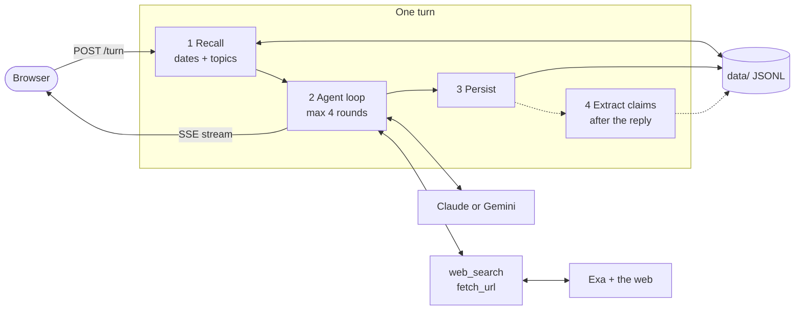
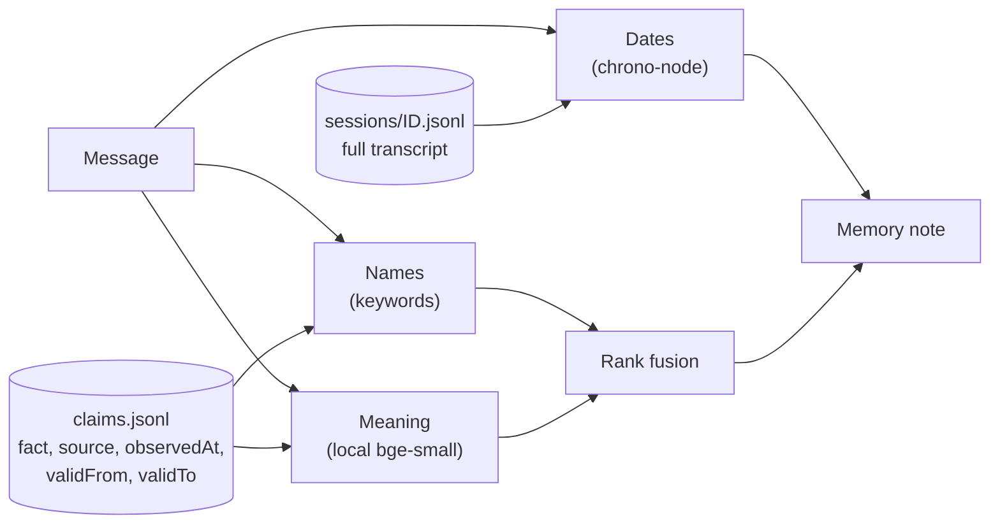
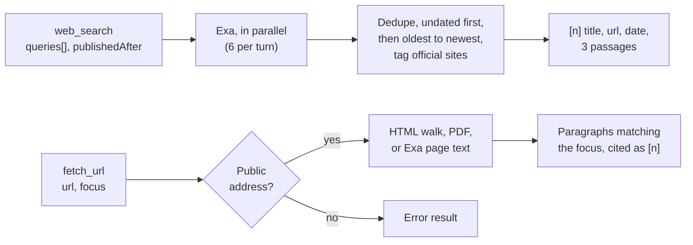

# minimi web search: design

The brief's sample questions look like search problems, but each starts with memory: which Monday, which five tools, what did I say then. So the agent treats its own earlier answers as dated claims and re-checks them against the web.

## How a turn works

Code does what must be right every time: the clock, turning "last Tuesday" into a date, finding the old conversation, saving the transcript. The model decides what to search, reads the results, and writes the answer.

1. The harness reads the message for dates and topics and writes a memory note before the model runs. There is no memory tool, so the model cannot forget to look.
2. The model can call several tools per round; they run in parallel. On the fourth round a note tells it to answer with what it has.
3. Every message is appended to the session file before the browser hears `done`.
4. A small structured call stores the answer's cited facts. It runs after the reply, and a failure there never reaches the user.

The server, the seed script and the eval all run this same function.

## Memory

Everything is JSON Lines in `data/`, so it survives restarts and needs no database. A session file is the append-only transcript of one conversation. Nothing earlier is ever edited, which keeps the model's prompt cache and preserved thinking valid across turns.

`claims.jsonl` holds what the agent said about the world, each fact with its source and the day it was seen. When a later answer finds a new value for the same thing, the old claim gets an end date and stays. That one idea comes from Zep's temporal graph; the graph itself was not needed.

Dates match message timestamps, and a date with nothing on it yields "No record for 3 Nov", so the agent never invents a conversation. Topics are found two ways and merged: keywords catch exact names and ignore filler like "compare" or "Pro", and a 34 MB embedding model running in-process catches paraphrases such as "that notebook you suggested". It embeds only short labels (titles, topics, claim subjects), because whole questions match on phrasing rather than subject. If the model is missing or slow, recall uses keywords alone.

`AGENT_NOW` moves "today" to any date, which is how `npm run seed` writes history for Monday, last Tuesday and 3 November through the normal code path.

## The web search tool

One capability, two halves: `web_search` finds pages and `fetch_url` reads one. Both sit behind a `SearchProvider` interface backed by Exa.

- One call carries several queries, so five CRM tools cost one round, not five. Smaller models make one call per round and ran out of rounds before this.
- `publishedAfter` turns "since Tuesday" into a date filter.
- Every result shows its date or `undated`, and the newest sit closest to where the model writes.
- Exa returns query-matched passages, so the model reads a few hundred characters per result.
- Vendor sites are tagged, and the prompt prefers them over reviews.
- Search results are never cached; a fetched page is cached for 15 minutes.

`fetch_url` walks the page itself, because pricing pages are cards and tables that article extractors drop. JavaScript pages and blocked sites fall back to Exa's text. Every failure (timeout, bad PDF, private address, the cap) returns an error result, and the model says what it could not check.

## What you see

Each answer streams with its sources above it. Every source card shows how old the page is, and "has it changed" answers add a before and after table. While the agent works, each search appears as its own chip; queries sent together spin together, so the parallel search is visible, and they fold into "5 searches, 1 page read" once the answer arrives. The empty screen shows the last two weeks of conversations as a timeline, so earlier work is one click away.

## Models

One internal message type, one translation file per provider. Anthropic is primary: `claude-opus-5-5` with adaptive thinking, `claude-haiku-5-5` for extraction, and the whole conversation cached each round. Gemini is the fallback and is what I developed and measured on, because I had no Anthropic key; the Anthropic path is unit-tested but has not run live.

## Considered and rejected

| Option | Why not |
| --- | --- |
| A memory tool | An extra model round, and the model can skip it |
| A knowledge graph | The questions are date and name lookups, not multi-hop |
| A vector database or embedding API | A local model compares a few hundred labels in milliseconds |
| The provider's built-in search | No control over dates, dedupe, caps or format |
| Planner, researcher and writer agents | More serial calls and more ways to fail |

## Results

One `npm run eval` run on 11 November 2026: 20 questions, live search, `gemini-3.5-flash-lite` answering and grading, during heavy Google overload.

| Answered | Correct | Cited | Searched only when needed | First word, no search | Median answer |
| --- | --- | --- | --- | --- | --- |
| 16 of 20 | 12 of 16 | 13 of 16 | 16 of 16 | 1.3 to 2.0 s | 15.8 s |

A separate recall check on real conversations recalls the right ones for 12 of 14 questions, and nothing for all four unrelated ones. 124 tests run without network. One run, my questions and a small grader make these indicative only.

## With another week

Long Gemini answers are sometimes cut off, probably because I never set its output budget, and the five-CRM question timed out in every overloaded run. I would fix the budget, check every figure in an answer against its cited passage in code, put the recall check in CI, start "has it changed" searches before the model's first call, and re-run the eval several times on Claude and `gemini-3.8-flash`.
