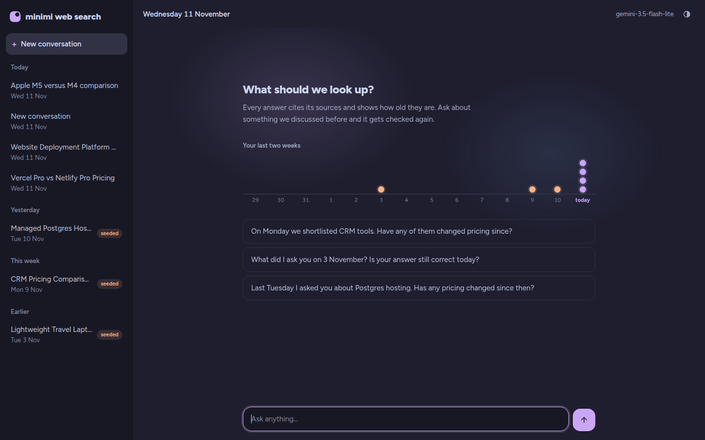
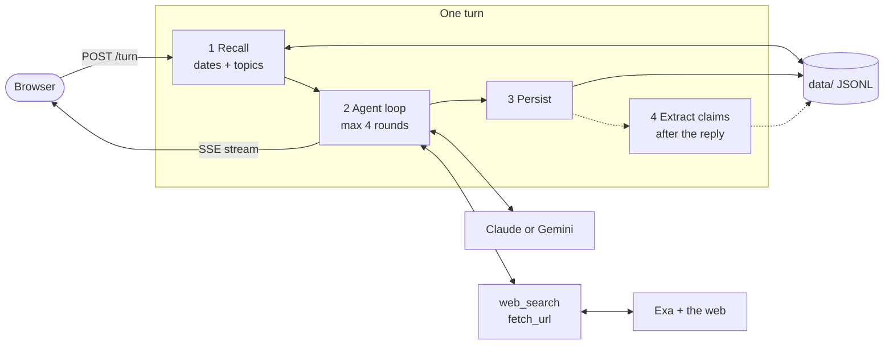

# minimi web search

A chat agent with one capability, web search, that remembers earlier conversations and re-checks what it said before. Ask "Last Tuesday I asked you about Postgres hosting. Has any pricing changed since then?" and it finds that conversation, searches each price again, and shows what changed with dated sources.



## How it works



Before the model runs, the server turns dates like "last Tuesday" into real days and finds the earlier conversations and facts that match, by date, by name, and by meaning. The model then searches the web, with several queries running in parallel, and streams an answer with numbered, dated sources. Afterwards the facts it cited are saved with today's date, so the next "has it changed?" question has something to check against.

[DESIGN.md](DESIGN.md) explains the decisions, what was rejected, and the eval results.

## Setup

You need Node 20 or newer and two API keys: one for search and one for a model.

| Key | Needed | Where to get it |
| --- | --- | --- |
| `EXA_API_KEY` | yes | [dashboard.exa.ai](https://dashboard.exa.ai/api-keys), free credits on signup |
| `GEMINI_API_KEY` | one of these two | [aistudio.google.com/apikey](https://aistudio.google.com/apikey), free tier |
| `ANTHROPIC_API_KEY` | one of these two | [console.anthropic.com](https://console.anthropic.com/settings/keys) |

```bash
cp .env.example .env    # then add your keys to .env
npm install
npm run dev             # http://localhost:3000
```

The first start downloads a 34 MB embedding model into `.cache/models`. Until it is ready, which takes a few seconds, memory matches by keywords only.

With both model keys set, Claude (`claude-opus-5-5`) is used. The header in the app always shows the active model.

## Try the memory questions

A fresh install has no history, so the memory questions have nothing to find. `npm run seed` writes three example conversations through the same code path a real chat uses, which takes about a minute and uses your keys:

- a laptop question on 3 November,
- a Postgres hosting comparison on the day "last Tuesday" means,
- a CRM shortlist on the day "on Monday" means.

They are marked "seeded" in the sidebar. Then click one of the three example questions on the empty screen. To seed again, delete `data/` first or pass `--force`.

## Configuration

All settings live in `.env`. Only the keys are required.

| Setting | What it does |
| --- | --- |
| `MODEL_PROVIDER` | `anthropic` or `gemini`; otherwise the first key found wins, Anthropic first |
| `ANTHROPIC_MODEL` | chat model on Anthropic, default `claude-opus-5-5` |
| `GEMINI_MODEL` | model on Gemini, default `gemini-3.8-flash` |
| `AGENT_NOW` | pretend today is another time, for example `2026-11-10T12:00:00`; the header turns orange while it is set |
| `PORT`, `HOST` | default `3000` on `127.0.0.1`, local only |
| `EVAL_JUDGE_MODEL` | eval only: grade answers with a different Gemini model |

## Tests and eval

```bash
npm test                                  # unit and HTTP tests, no network, no keys
npm run typecheck
npm run eval                              # 20 questions against the configured model
npm run eval brief-postgres no-record     # selected questions by id
```

The eval works on a throwaway copy of `data/`, so seeded memory is visible but nothing is written back. Results go to `eval/results-<provider>-<time>.json`.

## Where things are

```
src/main.ts         reads .env, picks the model, starts the server
src/server.ts       HTTP routes and the SSE stream
src/turn.ts         one turn: recall, loop, persist, extract (shared by server, seed and eval)
src/agent/          the tool loop and the system prompt
src/llm/            Claude and Gemini behind one interface
src/tools/          web_search and fetch_url, with Exa behind a SearchProvider interface
src/memory/         the JSONL store, recall, claim extraction, local embeddings
public/             the browser app, no build step
scripts/seed.ts     the example conversations
eval/               the questions and the graded runner
```

`data/` holds everything the agent remembers. `sessions/<id>.jsonl` is the full transcript of each conversation, and `claims.jsonl` holds the cited facts with the date each was seen and, once contradicted, the date it stopped being true. Delete the folder to start fresh.
